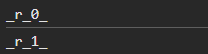

# useId

> دسته: React Hooks & Performance

از دستور `useId` برای ساخت `id` استفاده میشود

**نکته:** کاربرد اصلی `useId` ساخت `id` های یکتا و پایدار بین سرور و کلاینت (`SSR`) هست.

جایگزینی برای `key` در `map` و یا `selector` های `css` نیست

```jsx
const id = useId();
```

```jsx
const usernameId = useId();

const passwordId = useId();

console.log(usernameId);

console.log(passwordId);
```

خروجی `log`:


