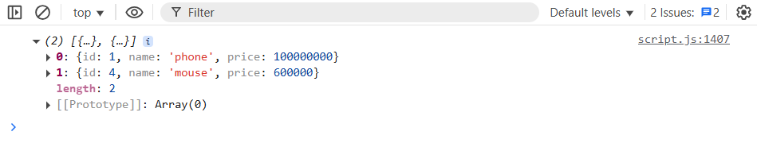

# filter

> دسته: JavaScript Basics (ES6+)

<div align="right" dir="rtl">
<code>filter</code> یه آرایه‌ی جدید برمی‌گردونه که فقط شامل عناصری هست که شرط داده‌شده رو پاس می‌کنن. آرایه‌ی اصلی دست‌نخورده می‌مونه.
</div>

<br/>

```jsx
const newArray = array.filter(function (number) {
  return number % 2 === 0;
});

const array2 = [
  { id: 1, name: "phone", price: 100_000_000 },

  { id: 2, name: "laptop", price: 500_000 },

  { id: 3, name: "keyboard", price: 80_000 },

  { id: 4, name: "mouse", price: 600_000 },
];

console.log(
  array2.filter(function (product) {
    return product.price > 500000;
  }),
);
```

خروجی دستور دوم:




**نکته:** `100_000_000` (با _) یه ویژگی `ES2021` هست به اسم `numeric separator `که فقط برای خوانایی بهتره و هیچ تأثیری روی مقدار عدد نداره.

