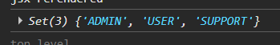

# New Set

> دسته: JavaScript Basics (ES6+)

از این دستور برای حذف مقادیر تکراری استفاده میشود:

```jsx
new Set(users.map((user) => user.role.value));
```

کاربرد: مثلا میخواهیم `type` کاربرهایی که از `API` میگیریم را به دست بیاوریم و میخواهیم مقادیر تکراری را حذف کنیم

خروجی این دستور یه `Set` هست یه نوع داده‌ی جدید (از `ES6`) که مقادیر یکتا رو نگه می‌داره و شبیه آرایه‌ست



**نکته:** `Set` متدهای آرایه (`map`/`filter`) رو نداره. برای استفاده از اون‌ها باید `Set` رو به آرایه تبدیل کنی:

```jsx
const uniqueRoles = [...new Set(users.map((u) => u.role.value))];
// یا
const uniqueRoles = Array.from(new Set(users.map((u) => u.role.value)));
```

**نکته:** `Set` از `SameValueZero` استفاده می‌کنه برای مقادیر (`number`, `string`, `boolean`) درست کار می‌کنه، ولی برای آبجکت‌ها بر اساس `reference` مقایسه می‌کنه

```jsx
new Set([{ id: 1 }, { id: 1 }]).size; // → 2 (چون reference ها فرق دارن)
```

این یه دام رایجه خیلی‌ها فکر می‌کنن `Set` آبجکت‌های یکسان رو حذف می‌کنه، ولی نمی‌کنه.

متد های `set`:

```jsx
const set = new Set([1, 2, 3]);

set.add(4); // اضافه کردن
set.has(2); // → true (چک کردن)
set.delete(2); // حذف
set.size; // → 3
set.clear(); // پاک کردن همه
```
