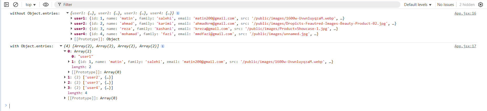

# Object.entries

> دسته: JavaScript Basics (ES6+)

<p align="right" dir="rtl">
<code>map</code> و بقیه‌ی متدهای آرایه فقط روی آرایه‌ها قابل استفاده‌ هستن. وقتی داده از <code>JSON import</code> می‌شه و به شکل <code>object</code> هست، نمی‌تونی مستقیم روش <code>map</code> بزنی. <code>Object.entries</code> این <code>object</code> رو به آرایه تبدیل می‌کنه تا بتونی از <code>map/filter/...</code> استفاده کنی.
</p>

```jsx
const entries = Object.entries(data);
```

در اینجا `data` مقدار `import` شده از فایل `JSON` میباشد

خروجی این دستور یه آرایه‌ست که هر عضو اون یه زوج `[key, value]` هست



_نکته:_ `Object.entries` فقط سطح اول `object` رو تبدیل می‌کنه. اگه `object` تودرتو داری، باید خودت بازگشتی (`recursive`) انجام بدی یا برای هر سطح جدا `Object.entries` بزنی.

<br/>

معکوسش: `Object.fromEntries`

```jsx
Object.fromEntries([
  ["a", 1],
  ["b", 2],
]);
// → { a: 1, b: 2 }
```

<br/>

<p align="right">
<code>Object.keys</code> و <code>Object.values</code>
</p>

```jsx
Object.keys({ a: 1, b: 2 }); // → ["a", "b"]
Object.values({ a: 1, b: 2 }); // → [1, 2]
Object.entries({ a: 1, b: 2 }); // → [["a", 1], ["b", 2]]
```
