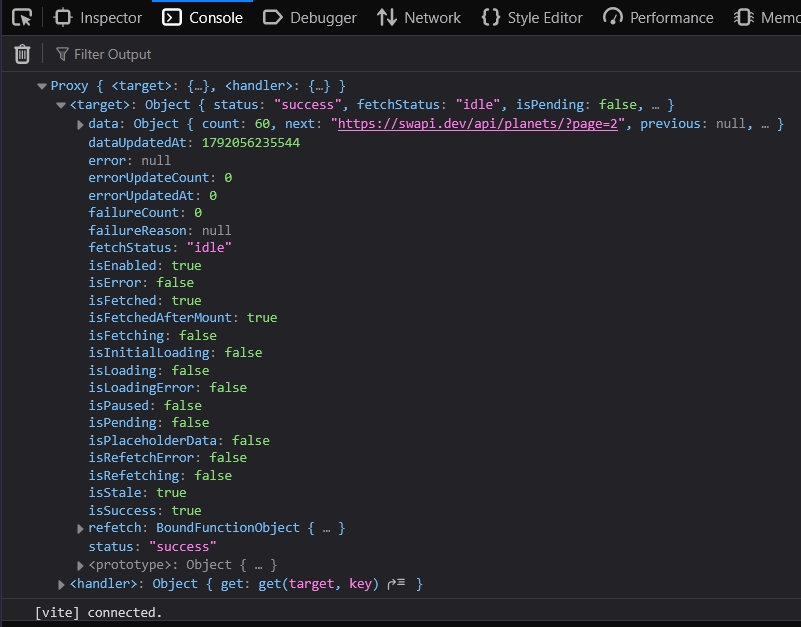

# useQuery

> دسته: Useful Packages & Tools

<div dir="rtl">
useQuery یه هوک از کتابخونه‌ی @tanstack/react-query هست که برای مدیریت fetch، caching، refetch و sync کردن داده‌های سرور با UI استفاده می‌شه.
</div>

<br/>

```jsx
const { data, status, isLoading } = useQuery({
  queryKey: ["peoples"],
  queryFn: fetchPlanets,
});
```

<div dir="rtl">
queryKey: یک key یکتا بهش میدهیم
</div>
<div dir="rtl">
queryFn: درخواست fetch را در قالب یک تابع بهش میدهیم
</div>

<br/>

<div dir="rtl">

**نکته‌ی مهم:** queryKey باید تمام مقادیری رو که queryFn بهشون وابسته‌ست، در بر بگیره
</div>

در خروجی مقادیر بسیاری هست که میتوان استفاده کرد اما 3 تا از پرکاربرد ترین آن:
<div dir="rtl">
data: مقدار بازگشتی از تابعی که به queryFn پاس دادیم
</div>
<div dir="rtl">
status: وضعیت درخواست (success,pending,error)
</div>
<div dir="rtl">
isLoading: مقدار Boolean</div>


<br/>

<div dir="rtl">
log زیر خروجی کامل (بدون destructuring) هست:
</div>

<br/>

