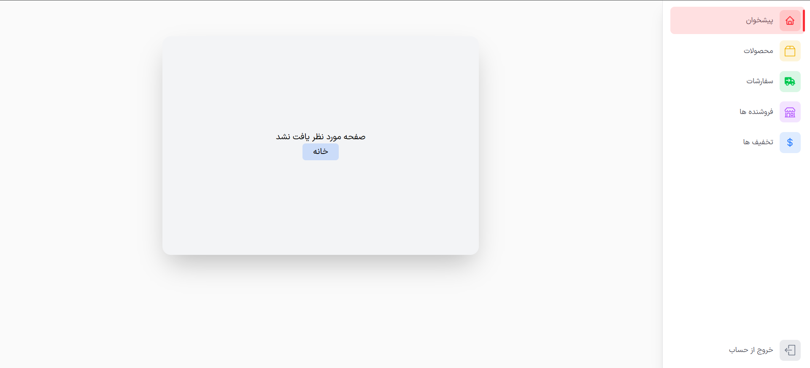

# Not Found

> دسته: React Router

برای مدیریت صفحه `not Found` از دستور زیر استفاده میکنیم:

```jsx
<Routes>
    <Route path="/home" element={<Home />} />
    <Route path="/about" element={<About />} />
    <Route path="/contactus" element={<ContactUs />} />
    <Route path="/login" element={<Login />} />
    <Route path="/*" element={<NotFound />} />
</Routes>
```

یک `Route` با `path` , `*` تعریف میکنیم. `*` یعنی (هر مسیری که با `route` های قبلی `match` نشده) , یعنی یه `fallback` برای مسیرهای ناشناخته, سپس در پراپ `element` کامپوننتی که برای `not Found` طراحی کرده ایم رو بهش میدهیم

در این حالت هر `Route` که کاربر دستی تایپ کند و وجود نداشته باشد صفحه `not Found` نمایش داده میشود

پیشنهاد خودم برای پیاده سازی `not Found` این هست که درون `nested` هر `route` جداگانه مسیردهی شود

```jsx
{

path: "/",
element: <RootLayout />,
children: [
    { index: true , element: <Home /> },

    { path: "product/:id", element: <ProductInfo /> },

    { path: "*", element: <NotFound /> },

  ],

},

{
path: "/adminpanel",
element: <AdminPanel />,

children: [
    { path: "download", element: <Download /> },

    { path: "setting", element: <Setting /> },

    { path: "*", element: <NotFoundAdmin /> },

  ],

},
```

<p align="right" dir="rtl">
<code>path="*"</code> = همه‌ی مسیرهای ناشناخته (توی همون سطح)<br/>
<code>path="/*"</code> = همه‌ی مسیرهای ناشناخته + زیرمسیرها
</p>

مانند `nested route` های بالا که میتوان برای `not Found` مربوط به هر کدام از `route` ها کامپوننت جداگانه ای در صورت نیاز رندر کرد

مثلا یک `not Found` مربوط به محصولات و یک `not Found` مربوط به تنظیمات `admin`

نکته: `not Found` در `router` مثل `event bubbling` عمل می‌کنه: اگه توی یه `route not Found` تعریف نکرده باشی، به `route` های بالاتر می‌ره تا یه `not Found` پیدا کنه و اجراش کنه.

خروجی روت اشتباه برای `dashboard` در صورت تعریف `not Found` برای روت های `dashboard` 👇



خروجی روت اشتباه در `dashboard` ولی بدون تعریف `not Found` برای روت های `dashboard`(در اینجا `not Found` کلی اجرا شده) 👇


می‌تونی به‌جای `*`، از `Navigate` هم استفاده کنی

به‌جای نمایش صفحه‌ی `404`، می‌تونی کاربر رو به صفحه‌ی دیگه‌ای هدایت کنی:

```jsx
<Route path="*" element={<Navigate to="/home" replace />} />
```
