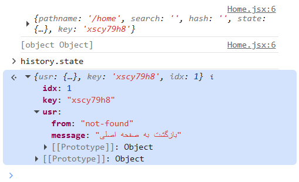

# ارسال state به route (Navigate state)

> دسته: React Router

ارسال `state` بین `route` ها

میتوان به `route` که کاربر به آن منتقل میشود یک `state` ارسال کرد:

```jsx
const navigate = useNavigate();

const goBackHandler = () => {
  navigate("/home", {
    state: { from: "not-found", message: "بازگشت به صفحه اصلی" },
  });
};
```

در کامپوننت مقصد هم میتوان با استفاده از `hook` , `useLocation` به این `state` دسترسی داشت

```jsx
function Home() {
  const loc = useLocation();

  console.log(loc);

  return <div>Home {loc.state?.message ?? "خوش آمدید"}</div>;
}
```

**نکته امنیتی:** `history.state` توی مرورگر ذخیره می‌شه و کاربر می‌تونه با `DevTools` ببینتش. پس نباید داده‌های حساس مثل توکن، ایمیل، شماره تلفن و... رو توش بذاری.



**نکته:** `history.state `فقط توی همون `session` مرورگر زنده‌ست. اگه کاربر صفحه رو `refresh` کنه، `state` از بین می‌ره. برای داده‌های پایدار، از `URL params` یا `localStorage` استفاده کن.
